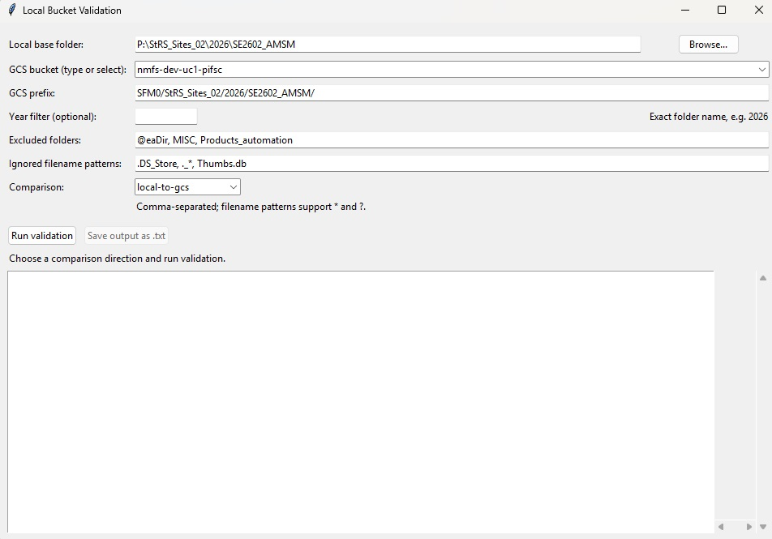

# SfM Archive Validation: Local to GCS Bucket



## Overview
The `sfm-archive-validation` repository provides automated validation and quality assurance scripts for Structure-from-Motion (SfM) photogrammetry archive packages generated by NOAA Pacific Islands Fisheries Science Center (PIFSC) during the local to cloud migration.

This project ensures that the images stored on local network drives are unmodified and synchronized with the images in the google cloud bucket. Being mid-cloud migration, processing is still happening locally which provides the possibility that the images may have been modified or moved.
This quality control tool ensures that the archive package prepped in the cloud (GCS) from the google cloud bucket is still valid before submission to long-term data repositories such as NCEI (National Centers for Environmental Information). Note the option to select local - gcs, gcs - local or both directions.

## Prerequisites
Before using these validation tools, ensure your environment meets the following requirements:

- **Python 3.8+**
- **Required Python Libraries:**
  - `pandas`
  - `pyyaml`
  - `jsonschema`
  - `tqdm`
- **System Utilities:**
  - Standard Unix terminal utilities (`md5sum` or equivalent for file integrity checksum verification).

Install Python dependencies via `pip`:
```bash
pip install pandas pyyaml jsonschema tqdm
```

## Installing
1. Clone the repository to your local environment or server:
   ```bash
   git clone https://github.com/LoriLuers-PIFSC/sfm-archive-validation.git
   ```

2. Change directory into the repository root:
   ```bash
   cd sfm-archive-validation
   ```

3. (Optional) Set up and activate a virtual environment:
   ```bash
   python3 -m venv venv
   source venv/bin/activate  # On Windows use: venv\Scripts\activate
   ```

4. Run the initial validation check test script:
   ```bash
   python validate_archive.py --help
   ```

## Resources
- [NOAA Fisheries Pacific Islands Fisheries Science Center (PIFSC)](https://www.fisheries.noaa.gov/region/pacific-islands)
- [NOAA InPort Metadata Catalog](https://www.fisheries.noaa.gov/inport/)
- [NOAA NCEI Ocean Archive](https://www.ncei.noaa.gov/)

## Version Control Platform
- Git

## License
See the [LICENSE.md](./LICENSE.md) for details

## Disclaimer
This repository is a scientific product and is not official communication of the National Oceanic and Atmospheric Administration, or the United States Department of Commerce. All NOAA GitHub project code is provided on an ‘as is’ basis and the user assumes responsibility for its use. Any claims against the Department of Commerce or Department of Commerce bureaus stemming from the use of this GitHub project will be governed by all applicable Federal law. Any reference to specific commercial products, processes, or services by service mark, trademark, manufacturer, or otherwise, does not constitute or imply their endorsement, recommendation or favoring by the Department of Commerce. The Department of Commerce seal and logo, or the seal and logo of a DOC bureau, shall not be used in any manner to imply endorsement of any commercial product or activity by DOC or the United States Government.
